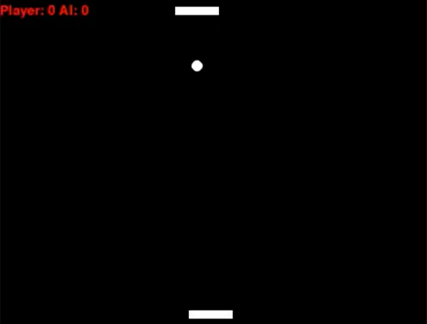
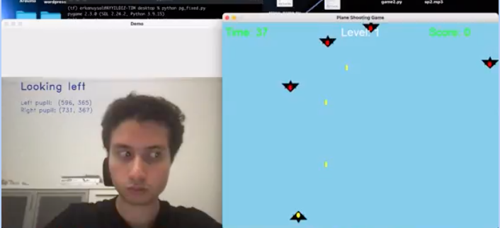
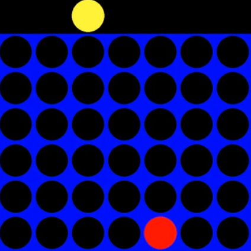
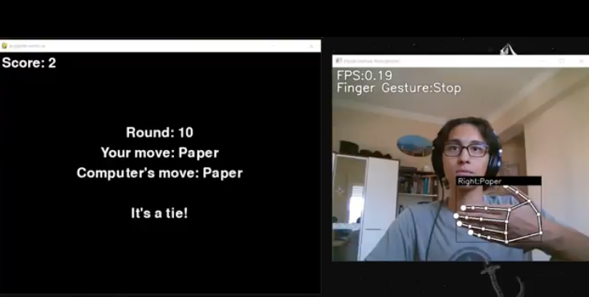
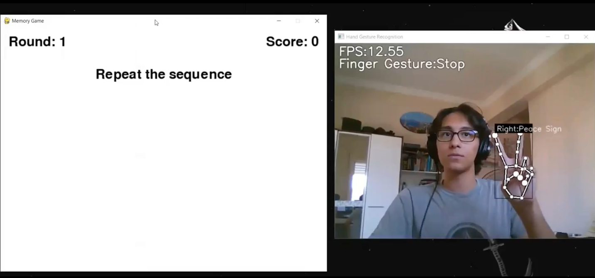
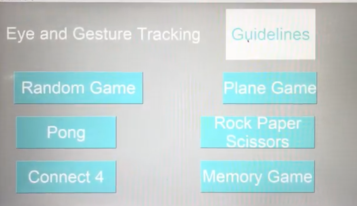

# KUSRP – Eye and Gesture Tracking

Research prototypes that explore gaze tracking and hand-gesture interaction for accessible games. Built for KUSRP with MediaPipe, OpenCV, Pygame, and lightweight TensorFlow Lite models. [Project slides](https://docs.google.com/presentation/d/1c72euZchOnjjG69ij6hfkjcXnWLtpI3-z6ThLAzSqHI/edit?usp=sharing)

## Contents
- [Overview](#overview)
- [Features](#features)
- [Tech stack](#tech-stack)
- [Repository map](#repository-map)
- [Setup](#setup)
- [Run the demos](#run-the-demos)
- [Train or extend gestures](#train-or-extend-gestures)
- [Outputs and housekeeping](#outputs-and-housekeeping)
- [Troubleshooting](#troubleshooting)
- [Gallery](#gallery)
- [Acknowledgements](#acknowledgements)

## Overview
This repo collects several webcam-driven prototypes that combine gaze tracking (for left/right/bink input) with hand-gesture recognition. Games include Pong, Rock-Paper-Scissors, a Simon-style memory game, a gaze-controlled plane shooter, and UI mockups that stitch them together.

## Features
- Eye-tracked Pong that uses FaceMesh-based blink and gaze detection, audio cues, and gameplay recording.
- Hand-gesture recognizer for both static signs and fingertip motion sequences using MediaPipe Hands plus TFLite MLP classifiers.
- Gesture-controlled games: Rock-Paper-Scissors, memory/Simon, Connect 4 prototype, and a gaze-guided plane shooter.
- Re-trainable pipeline: data collection built into the demos, notebooks to regenerate models, and a shared set of `.tflite` assets.
- Presentation-ready assets, including screenshots and a slide deck.

## Tech stack
- Python 3.9+
- OpenCV, MediaPipe, TensorFlow Lite, NumPy
- Pygame, PySimpleGUI, vidmaker

## Repository map
- `Eye Tracking/` — Gaze and blink detection feeding a Pygame Pong variant (`main.py`), plus a keyboard baseline (`pong.py`) and overlay utilities (`utils.py`).
- `Hand Gesture/` — Base gesture-recognition pipeline (`app.py`), training notebooks, FPS helpers, and pretrained models under `model/`.
- `Memory_Game/` — Gesture-controlled memory game; `Intregrated Memory Game/Memory_Game_Integrated.py` runs the full Pygame + webcam experience.
- `Rock-Paper-Scissors/` — Gesture-powered RPS demo built on the same classifier stack.
- `Plane_Game/` — Gaze-controlled plane shooter (`plane_game.py`) with a lightweight gaze-tracking helper.
- `UI/` — PySimpleGUI launcher (`main.py`) and integrated prototypes for Connect 4, Pong, RPS, Memory Game, and Plane Game.
- `Rock_Paper_Scissors_Game/` — Standalone RPS workflow with notebooks and models (original MediaPipe reference adapted here).
- `images/` — Screenshots used in this README.
- `requirements.txt` — Python dependencies for all demos.

## Setup
1) Install Python 3.9+ and ensure your webcam and speakers are available.  
2) Create a virtual environment and install dependencies:
```bash
python -m venv .venv
source .venv/bin/activate
pip install -r requirements.txt
```

## Run the demos
- Eye-tracked Pong (blink/gaze + audio, records MP4s)
  ```bash
  cd "Eye Tracking"
  python main.py
  ```
  Generates `OutputPong.mp4` (vidmaker) and `output1.mp4` (OpenCV).

- Hand-gesture recognizer (base demo and data logger)
  ```bash
  cd "Hand Gesture"
  python app.py
  ```
  Uses pretrained models in `model/`. Press `k` to log static keypoints or `h` to log point-history sequences while collecting new samples.

- Memory game (gesture-driven Simon)
  ```bash
  cd Memory_Game
  python "Intregrated Memory Game/Memory_Game_Integrated.py"
  ```
  Watch the on-screen sequence, then repeat it with your hand in view of the webcam.

- Rock-Paper-Scissors (gesture control)
  ```bash
  cd "Rock-Paper-Scissors"
  python app.py
  ```

- Plane shooter (gaze control)
  ```bash
  cd Plane_Game
  python plane_game.py
  ```

- GUI launcher (optional)
  ```bash
  cd UI
  python main.py
  ```
  Opens a PySimpleGUI menu to start the bundled games.

## Train or extend gestures
1) Collect data: In `Hand Gesture/app.py` (or `Rock-Paper-Scissors/app.py`), press `k` for static keypoints and `h` for fingertip trajectories. Samples are appended to `model/keypoint_classifier/keypoint.csv` and `model/point_history_classifier/point_history.csv`.  
2) Update labels: Edit `model/keypoint_classifier/keypoint_classifier_label.csv` and `model/point_history_classifier/point_history_classifier_label.csv` to include your new classes.  
3) Retrain: Run `keypoint_classification.ipynb` or `point_history_classification.ipynb` to generate new `.tflite` models (adjust `NUM_CLASSES` as needed).  
4) Deploy: Replace the `.tflite` files in `model/` for each demo to use your custom gestures.

## Outputs and housekeeping
- Recording-heavy scripts (for example, `Eye Tracking/main.py`) write MP4 files to their working directory. Clear large artifacts before committing.  
- Collected gesture CSVs grow quickly; archive or reset them when starting a fresh dataset.

## Troubleshooting
- If MediaPipe complains about `protobuf`, upgrade: `pip install --upgrade protobuf`.  
- Ensure only one app is using the webcam at a time, and run inside the activated virtual environment.

## Gallery
- Eye-tracked Pong  
  

- Plane game (gaze control)  
  

- Connect 4 (gesture control)  
  

- Rock-Paper-Scissors (gesture recognition)  
  

- Memory game (gesture sequence)  
  

- Main menu prototype  
  

## Acknowledgements
Based on the MediaPipe hand-gesture pipeline from Kazuhito Takahashi (https://github.com/Kazuhito00/hand-gesture-recognition-using-mediapipe) and the English translation by Nikita Kiselov. This repo adapts that work for gaze tracking and gesture-driven games.
